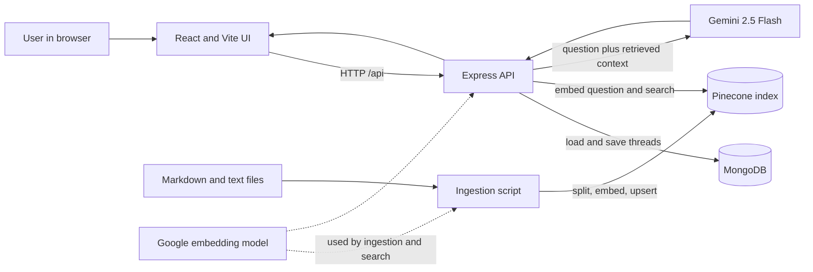

# OpenChat with RAG

OpenChat is a full-stack AI chat application with persistent conversations and optional Retrieval-Augmented Generation (RAG). It uses Google Gemini for assistant responses, MongoDB for chat threads, and Pinecone to retrieve relevant passages from a project knowledge base.

When RAG is configured, the backend searches the knowledge base for passages related to each question and supplies them to Gemini as context. If RAG is not configured, or retrieval fails or returns no results, chat falls back to a regular Gemini response.

## Contents

- [Features](#features)
- [What It Solves](#what-it-solves)
- [Technology Stack](#technology-stack)
- [Architecture](#architecture)
- [RAG Pipeline](#rag-pipeline)
- [Run Locally](#run-locally)
- [Run with Docker Compose](#run-with-docker-compose)
- [Project Structure](#project-structure)
- [API](#api)
- [Ideas for Improvement](#ideas-for-improvement)
- [Useful Links](#useful-links)

## Features

- Chat UI with multiple conversation threads.
- Persistent thread titles, messages, and timestamps in MongoDB.
- Gemini-powered assistant responses.
- Optional RAG over Markdown and text files in `Backend/knowledge_base/`.
- Pinecone similarity search with retrieved source filenames included in the model context.
- Markdown rendering and syntax highlighting for assistant replies.
- Docker Compose setup for the frontend, backend, and MongoDB.
- Graceful retrieval fallback: chat can still answer without Pinecone context.

## What It Solves

A general-purpose language model may not know private, project-specific, or recently maintained information. OpenChat provides a straightforward way to make a chat assistant answer questions using a curated set of documents. RAG retrieves relevant passages for each question and places them in the prompt, helping responses stay grounded in the available material without training a model on those documents.

The application also supplies the surrounding chat product basics: a browser interface, conversation history, and persistent storage.

## Technology Stack

| Area | Technology | Role |
| --- | --- | --- |
| Frontend | React 19, Vite | Chat interface and development/build tooling |
| Rendering | `react-markdown`, `rehype-highlight` | Markdown and code-block rendering |
| Backend | Node.js, Express 5 | Chat and thread HTTP API |
| Chat model | Gemini 2.5 Flash through Google's OpenAI-compatible endpoint | Generates assistant replies |
| Embeddings | Google Generative AI embeddings (`gemini-embedding-001`) | Converts questions and document chunks to vectors |
| Vector search | Pinecone, LangChain | Stores and retrieves knowledge-base vectors |
| Persistence | MongoDB, Mongoose | Stores threads and messages |
| Containers | Docker, Docker Compose, Nginx | Runs the app services and serves/proxies the frontend |

## Architecture



The browser sends chat and thread requests to the Express API. For each chat message, the API retrieves context when RAG is configured, asks Gemini for a reply, and stores the user and assistant messages in the thread document. MongoDB and Pinecone have separate responsibilities: MongoDB stores conversation history; Pinecone stores searchable knowledge-base vectors.

## RAG Pipeline

### Indexing documents

1. Add `.md` or `.txt` documents to `Backend/knowledge_base/`.
2. Run `npm run ingest` from `Backend/`.
3. `Backend/scripts/ingest.js` loads each supported file and records its filename as document metadata.
4. LangChain's `RecursiveCharacterTextSplitter` divides text into chunks of 500 characters with 50 characters of overlap.
5. Google `gemini-embedding-001` converts each chunk into an embedding, and the script writes the chunks and vectors to the configured Pinecone index.

### Answering a question

1. The chat route receives a user message and calls `Backend/utils/rag.js`.
2. The question is embedded and Pinecone similarity search returns up to four relevant chunks.
3. The backend adds the retrieved text and source filenames to the prompt sent to Gemini 2.5 Flash.
4. Gemini generates the reply, which is saved to MongoDB and returned to the browser.

The current prompt asks the model to use retrieved context, but if the context does not contain an answer, it permits the model to answer from its own knowledge. This is useful for a general assistant, but it is not a strict source-only or citation-enforcing mode.

More detail is available in [`Backend/knowledge_base/rag-pipeline.md`](Backend/knowledge_base/rag-pipeline.md) and [`Backend/knowledge_base/openchat-overview.md`](Backend/knowledge_base/openchat-overview.md).

## Run Locally

### Prerequisites

- Node.js 22.12 or newer and npm (recommended for the Vite 8 frontend; the backend Docker image uses Node.js 18).
- A running MongoDB instance (local or hosted).
- A Google AI Studio API key for Gemini chat. Use the same key for embeddings if enabling RAG.
- A Pinecone API key and index only if enabling RAG.

### 1. Configure the backend

Create `Backend/.env` with:

```dotenv
GEMINI_API_KEY=your_google_ai_studio_key
MONGODB_URI=mongodb://127.0.0.1:27017/openchat

# Required only for RAG and document ingestion
PINECONE_API_KEY=your_pinecone_api_key
PINECONE_INDEX_NAME=your_index_name
```

The Pinecone index must be configured for the vector dimension produced by `gemini-embedding-001`. Keep API keys private and do not commit `.env` files.

### 2. Install and start the backend

```bash
cd Backend
npm install
npm run dev
```

The API listens on `http://localhost:8080`.

### 3. Install and start the frontend

In a second terminal:

```bash
cd Frontend
npm install
npm run dev
```

Open the Vite URL printed in the terminal. The frontend currently calls the API at `http://localhost:8080`, so keep the backend on that port while using the Vite development server.

### 4. Ingest the knowledge base (RAG only)

With the backend environment configured and Pinecone index available:

```bash
cd Backend
npm run ingest
```

Re-run ingestion after adding or editing knowledge-base files. This script upserts document chunks; it does not currently clear old vectors or track document versions, so repeated ingestion after substantial document changes may leave stale chunks in the index.

## Run with Docker Compose

Docker Compose runs the frontend on port `3000`, the backend on port `8080`, and MongoDB on its internal Compose network.

1. Create `Backend/.env` and set at least `GEMINI_API_KEY`. Add the two Pinecone variables if using RAG.
2. From the project root, start the stack:

```bash
docker compose up --build
```

3. Open [http://localhost:3000](http://localhost:3000).

Compose sets `MONGODB_URI` to the Compose MongoDB service and persists database files in the `mongo_data` volume. The backend `.env` file is required by the Compose configuration even when running without RAG. To stop the services, press `Ctrl+C`, then run `docker compose down`. The named MongoDB volume is retained unless explicitly removed.

To ingest documents in the containerized setup, run the one-off script with the backend service environment after starting the stack:

```bash
docker compose exec backend npm run ingest
```

## Project Structure

```text
.
├── Backend/
│   ├── knowledge_base/       # Markdown/text source documents
│   ├── models/Thread.js      # MongoDB thread/message schema
│   ├── routes/chat.js        # Chat and thread API routes
│   ├── scripts/ingest.js     # Document chunking and vector indexing
│   ├── utils/
│   │   ├── openai.js         # Gemini chat request and prompt construction
│   │   ├── rag.js            # Runtime retrieval
│   │   └── vectorStore.js    # Gemini embeddings and Pinecone setup
│   └── server.js             # Express app and MongoDB connection
├── Frontend/
│   └── src/                  # React chat UI
└── docker-compose.yml        # Local multi-service stack
```

## API

| Method | Path | Purpose |
| --- | --- | --- |
| `POST` | `/api/chat` | Send a message; creates or updates a thread and returns the assistant reply |
| `GET` | `/api/thread` | List conversation threads, newest updated first |
| `GET` | `/api/thread/:threadId` | Get messages for a thread |
| `DELETE` | `/api/thread/:threadId` | Delete a thread |
| `POST` | `/api/test` | Test route that creates a sample thread |

## Ideas for Improvement

- **Configurable API URL:** move the frontend's hard-coded `http://localhost:8080` into a Vite environment variable and use the Nginx `/api` proxy in production.
- **Safer API behavior:** validate inputs, return consistent errors, add health checks, and avoid returning raw provider errors to clients.
- **Reliability:** wait for MongoDB readiness before accepting requests; add retries/timeouts and verify Gemini response status and shape before reading its content.
- **RAG quality:** make chunk size and top-k configurable, add metadata filters and relevance thresholds, and evaluate retrieval against a small question/answer test set.
- **Source transparency:** return retrieved source metadata to the frontend and render citations; consider a strict mode that does not answer beyond retrieved evidence.
- **Index lifecycle:** use stable document IDs, remove obsolete chunks on re-ingestion, and record document hashes/version metadata to make indexing repeatable.
- **Security and operations:** add authentication, rate limiting, request limits, secret management, structured logs, and monitoring before exposing the service publicly.
- **Conversation quality:** include recent thread history in the model request; the current request sends only the latest user message plus retrieved context.
- **Testing and maintainability:** add backend/API and RAG tests, a CI workflow, a `.env.example`, and TypeScript or stronger runtime validation as the project grows.

## Useful Links

- [React](https://react.dev/)
- [Vite](https://vite.dev/)
- [Express](https://expressjs.com/)
- [MongoDB](https://www.mongodb.com/docs/)
- [Mongoose](https://mongoosejs.com/docs/)
- [Google AI Studio](https://aistudio.google.com/)
- [Gemini API documentation](https://ai.google.dev/gemini-api/docs)
- [Pinecone documentation](https://docs.pinecone.io/)
- [LangChain JS documentation](https://js.langchain.com/docs/)
- [Docker Compose](https://docs.docker.com/compose/)